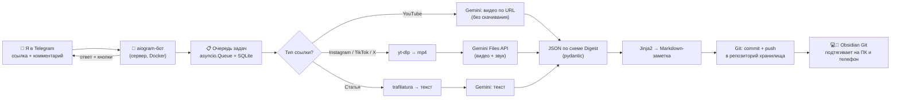

> Источник: заметка «Link2Note — бот «Посмотрю потом»» из Obsidian (копия от 08.11.2026).
> Если план меняется — правь здесь и в Obsidian.

# 📥 Link2Note — Telegram-бот «Посмотрю потом»

> [!abstract] Идея в одну фразу
> Кидаю боту ссылку на любое полезное видео (YouTube, Instagram Reels, TikTok) или статью → ИИ смотрит/читает его за меня → в Obsidian появляется **готовый конспект**: суть, шаги, горячие клавиши, команды, упомянутые книги и чек-лист «что сделать». В свободное время просто читаю заметку, а не ищу и пересматриваю видео.

> [!info] Откуда проект
> Это перерождение Телеграм бот для мамы на др: мама им почти не пользуется, а вся инфраструктура уже есть — `aiogram 3`, `APScheduler`, SQLite, `faster-whisper`, Docker и домашний сервер 24/7. Переиспользую репозиторий `Desktop\Projects\assistant_bot`.

---

## 1. 🎯 Какую проблему решает
- В ленте постоянно попадаются полезные видео: «5 горячих клавиш VS Code», «как настроить Proxmox», «книга, которая изменит…». Сохраняю — и **никогда не возвращаюсь**: нет времени пересматривать 10 минут ради 3 фактов.
- Ссылки теряются в «Избранном» Telegram и сохранёнках Instagram.
- **Решение:** превратить «посмотрю потом» в **«прочитаю потом за 2 минуты»** — текст в моём втором мозге, со ссылками, тегами и задачами.

## 2. ✅ Что бот должен уметь (MVP → дальше)
| Фича | Этап |
|---|---|
| Принять ссылку (текст, пересланное сообщение, подпись к посту) | MVP |
| YouTube / Shorts → конспект через Gemini **без скачивания** | MVP |
| Записать заметку в `03 - Resources/📥 Из ссылок/` и отправить в Git | MVP |
| Ответить в Telegram: название + TL;DR + «заметка добавлена» | MVP |
| Только мой Telegram ID (белый список) | MVP |
| Instagram Reels / TikTok / X → скачать через `yt-dlp` → Gemini | Этап 2 |
| Статьи и веб-страницы → `trafilatura` → текст → Gemini | Этап 2 |
| Дубликаты: та же ссылка → «уже есть: [заметка]» | Этап 2 |
| Мой комментарий к ссылке = подсказка ИИ («сделай упор на хоткеи») | Этап 2 |
| Кнопки: 🔁 Подробнее · ✅ Прочитано · 🗑 Удалить | Этап 3 |
| Воскресный дайджест «📚 5 непрочитанных конспектов» | Этап 3 |
| Голосовое сообщение-идея → заметка (Whisper уже есть) | Этап 3 |
| Карточки Anki из конспекта → Other AI asistant for Anki | Этап 4 |
| Поиск по конспектам через RAG второго мозга → ai_hybrid_architecture | Этап 4 |

---

## 3. 🏗️ Архитектура



### Почему именно так
- **Gemini, а не Claude/ChatGPT, для видео:** Gemini API понимает видео целиком — **и картинку, и звук**. Это критично для роликов, где горячие клавиши или код показаны *на экране*, а не проговорены. А ещё YouTube-ссылку можно передать прямо в запрос, ничего не скачивая.
- **Claude** можно подключить вторым провайдером для текстов (статьи, транскрипты) — переключатель `LLM_PROVIDER` в `.env`.
- **Git вместо прямой записи в файлы:** хранилище и так синхронизируется через GitHub (Git-synchronization of vault). Бот на сервере держит свой клон, кладёт новую заметку и делает `push` — через минуту она есть и на ПК, и на телефоне. Бот пишет **только новые файлы в свою папку**, поэтому конфликтов почти не будет.
- **Очередь:** видео обрабатывается 20–90 секунд. Очередь не даёт боту зависнуть, если кинуть 5 ссылок подряд, и переживает перезапуск сервера (задачи в SQLite).

---

## 4. 🔍 Как получать контент из разных источников

| Источник | Как получаем | Нюансы |
|---|---|---|
| **YouTube** (видео, Shorts) | URL передаётся прямо в Gemini (`file_data.file_uri`) | Только **публичные** видео (не unlisted/private). На free tier — до **8 часов видео в день**. Функция в preview, пока бесплатна. |
| **Instagram Reels** | `yt-dlp` скачивает mp4 → `client.files.upload()` → Gemini | Instagram часто требует вход → файл `cookies.txt` из браузера (экспорт расширением). Ролики короткие — дёшево. |
| **TikTok, X, Vimeo, Reddit** | `yt-dlp` (поддерживает 1000+ сайтов) → Files API | Проверять длительность **до** скачивания (`extract_info(download=False)`). |
| **Статьи, блоги, документация** | `httpx` + `trafilatura` (чистый текст без меню и рекламы) → Gemini | Для paywall не сработает — тогда бот честно говорит «не смог прочитать». |
| **Книга** (название текстом) | Просто текст → Gemini: краткое содержание, главные идеи | Помечать `confidence: medium` — это знания модели, а не источник. |
| **Голосовое** | `faster-whisper` (уже есть в боте) → текст → заметка-идея | Этап 3 |

> [!tip] Запасной путь
> Если Gemini не смог обработать видео (лимит, ошибка), бот достаёт **только аудио** через `yt-dlp`, расшифровывает его `faster-whisper` локально и делает конспект по тексту. Хуже для «показали на экране», но лучше, чем ничего.

**Стоимость:** при `media_resolution=LOW` видео стоит ~**100 токенов/сек** → 10-минутный ролик ≈ 60 000 токенов. Для личного использования (5–10 ссылок в день) хватает **бесплатного уровня** Gemini (ориентир ~1 500 запросов в день для Flash-моделей; точные лимиты — в AI Studio).

---

## 5. 📝 Как выглядит заметка-результат

Шаблон для ручного создания — Template_Link_Digest. Бот генерирует ровно такую же структуру:

```markdown
---
type: digest
status: unread
source: youtube
url: https://youtu.be/xxxx
author: Fireship
duration: "08:42"
date_added: 2026-10-27
read_minutes: 3
confidence: high
tags: [dev]
---
# ⌨️ 10 горячих клавиш VS Code, которые экономят часы

> [!tldr] Суть за 10 секунд
> Мультикурсор, быстрый переход по символам и перемещение строк — 80% выигрыша по скорости.

## 🔑 Главное
- ...

## ⌨️ Горячие клавиши
| Действие | Windows | macOS |
|---|---|---|
| Курсор на все совпадения | `Ctrl+Shift+L` | `Cmd+Shift+L` |

## 🪜 Пошагово / Как применить
1. ...

## 💻 Команды и код
## 📚 Упомянутые ресурсы
## ✅ Что сделать
- [ ] Попробовать мультикурсор на следующей лабе по OOP

## ⏱️ Таймкоды
- [02:15](https://youtu.be/xxxx?t=135) — мультикурсор

---
🔗 📥 Из ссылок (MOC) · Источник: [YouTube](https://youtu.be/xxxx)
```

Секции без содержимого бот **не выводит** (нет кода в видео → нет раздела «Команды»). Теги — только из моего списка, максимум 3.

---

## 6. 🧱 Структура кода (расширяем `assistant_bot`)

```text
assistant_bot/
├── main.py                  # старт бота + планировщика + воркера очереди
├── config.py                # 🆕 настройки из .env (pydantic-settings)
├── database.py              # + таблица digests
├── scheduler.py             # + воскресный дайджест
├── handlers/
│   ├── reminders.py         # старый функционал (можно оставить)
│   └── links.py             # 🆕 приём ссылок, кнопки
├── digest/                  # 🆕 весь новый функционал
│   ├── classifier.py        # тип ссылки
│   ├── fetchers.py          # yt-dlp, trafilatura
│   ├── llm.py               # Gemini (+ опционально Claude)
│   ├── schema.py            # pydantic-модель Digest
│   ├── render.py            # Jinja2 → Markdown
│   ├── vault.py             # git pull / commit / push
│   ├── worker.py            # очередь задач
│   └── templates/note.md.j2
├── tests/                   # 🆕 pytest
├── Dockerfile               # ffmpeg уже есть ✅
└── docker-compose.yml       # + volume для клона хранилища и ssh-ключа
```

### 6.1 `classifier.py` — какой это источник
```python
import re
from enum import Enum
from urllib.parse import parse_qs, urlparse

URL_RE = re.compile(r"https?://[^\s<>\"]+")


class Source(str, Enum):
    YOUTUBE = "youtube"
    INSTAGRAM = "instagram"
    TIKTOK = "tiktok"
    VIDEO = "video"  # любые другие сайты, которые понимает yt-dlp
    ARTICLE = "article"


VIDEO_HOSTS = {"x.com", "twitter.com", "vimeo.com", "reddit.com", "facebook.com"}


def classify(url: str) -> Source:
    host = urlparse(url).netloc.lower().removeprefix("www.").removeprefix("m.")
    if host in {"youtube.com", "youtu.be", "music.youtube.com"}:
        return Source.YOUTUBE
    if host.endswith("instagram.com"):
        return Source.INSTAGRAM
    if host.endswith("tiktok.com"):
        return Source.TIKTOK
    if host in VIDEO_HOSTS:
        return Source.VIDEO
    return Source.ARTICLE


def normalize(url: str) -> str:
    """Убираем мусор (?si=, utm_…), чтобы находить дубликаты.
    Для YouTube оставляем только ID видео: youtu.be/ID, /watch?v=ID и /shorts/ID → одно и то же."""
    u = urlparse(url)
    host = u.netloc.lower().removeprefix("www.").removeprefix("m.")
    if host == "youtu.be":
        return f"youtube:{u.path.strip('/')}"
    if host.endswith("youtube.com"):
        vid = parse_qs(u.query).get("v", [""])[0] or u.path.rstrip("/").split("/")[-1]
        return f"youtube:{vid}"
    return f"{host}{u.path}".rstrip("/")
```

### 6.2 `schema.py` — что ИИ должен вернуть
Структурированный JSON вместо «свободного текста» → заметки всегда одинаково оформлены, а бот не ломается на странном ответе.
```python
from pydantic import BaseModel, Field


class Shortcut(BaseModel):
    action: str
    windows: str = ""
    mac: str = ""


class CodeBlock(BaseModel):
    language: str = "bash"
    code: str
    explanation: str = ""


class Resource(BaseModel):
    kind: str  # book | tool | site | video | course
    name: str
    note: str = ""


class Timestamp(BaseModel):
    seconds: int
    label: str


class Digest(BaseModel):
    title: str = Field(description="Понятный заголовок на русском, до 80 символов")
    emoji: str = Field(description="Одно эмодзи по теме")
    tldr: str = Field(description="Суть в 1–2 предложениях")
    key_points: list[str]
    steps: list[str] = []  # пошаговая инструкция, если есть
    shortcuts: list[Shortcut] = []
    code: list[CodeBlock] = []
    resources: list[Resource] = []
    action_items: list[str] = []  # что мне конкретно сделать
    timestamps: list[Timestamp] = []
    tags: list[str] = Field(description="1–3 тега ТОЛЬКО из разрешённого списка")
    read_minutes: int
    confidence: str = Field(description="high | medium | low — насколько уверен, что всё понял")
```

### 6.3 `llm.py` — запрос к Gemini
```python
import asyncio
from google import genai
from google.genai import types

from config import settings
from digest.schema import Digest

client = genai.Client(api_key=settings.gemini_api_key)

ALLOWED_TAGS = [
    "dev",
    "ai",
    "homelab",
    "university",
    "romanian",
    "nuclear",
    "driving",
    "cooking",
    "sport",
    "health",
    "finance",
    "planning",
    "games",
    "books",
    "personal",
    "obsidian",
]

SYSTEM = f"""Ты — мой ассистент по конспектам. Сделай из материала заметку для Obsidian на русском.
Правила:
- Пиши только то, что реально есть в материале. Не выдумывай. Если не уверен — confidence=low.
- Горячие клавиши, команды, названия программ и книг переписывай ТОЧНО, как в видео (смотри и на экран, и на звук).
- Технические термины оставляй на английском.
- steps — только если в материале есть процесс/инструкция.
- action_items — 1–3 конкретных действия для меня (студент Information Engineering, Python/Java, homelab, Obsidian).
- tags — 1–3 из списка: {", ".join(ALLOWED_TAGS)}.
"""


def _config():
    return types.GenerateContentConfig(
        system_instruction=SYSTEM,
        response_mime_type="application/json",
        response_schema=Digest,
        media_resolution=types.MediaResolution.MEDIA_RESOLUTION_LOW,  # ~100 токенов/сек видео
        temperature=0.2,
    )


async def digest_youtube(url: str, hint: str = "") -> Digest:
    resp = await client.aio.models.generate_content(
        model=settings.gemini_model,  # например "gemini-3.8-flash"
        contents=types.Content(
            parts=[
                types.Part(file_data=types.FileData(file_uri=url)),
                types.Part(text=f"Сделай конспект этого видео. {hint}"),
            ]
        ),
        config=_config(),
    )
    return _clean(resp.parsed)


async def digest_video_file(path: str, hint: str = "") -> Digest:
    f = await client.aio.files.upload(file=path)
    while f.state.name == "PROCESSING":  # ждём обработку на стороне Google
        await asyncio.sleep(2)
        f = await client.aio.files.get(name=f.name)
    if f.state.name != "ACTIVE":
        raise RuntimeError(f"Gemini не смог обработать файл: {f.state.name}")
    try:
        resp = await client.aio.models.generate_content(
            model=settings.gemini_model,
            contents=[
                types.Part.from_uri(file_uri=f.uri, mime_type=f.mime_type),
                f"Сделай конспект этого видео. {hint}",
            ],
            config=_config(),
        )
        return _clean(resp.parsed)
    finally:
        await client.aio.files.delete(name=f.name)  # не копим файлы в облаке


async def digest_text(text: str, hint: str = "") -> Digest:
    resp = await client.aio.models.generate_content(
        model=settings.gemini_model,
        contents=f"Сделай конспект этой статьи. {hint}\n\n{text[:200_000]}",
        config=_config(),
    )
    return _clean(resp.parsed)


def _clean(d: Digest) -> Digest:
    d.tags = [t for t in d.tags if t in ALLOWED_TAGS][:3] or ["personal"]
    return d
```

### 6.4 `fetchers.py` — скачать видео / текст статьи
```python
import asyncio, tempfile
from pathlib import Path
import httpx, trafilatura, yt_dlp
from config import settings

MAX_SECONDS = 60 * 60  # не берём видео длиннее часа


def _download(url: str, out_dir: str) -> tuple[str, dict]:
    opts = {
        "format": "mp4[height<=720]/best[height<=720]/best",
        "outtmpl": f"{out_dir}/%(id)s.%(ext)s",
        "noplaylist": True,
        "quiet": True,
        "max_filesize": 300 * 1024 * 1024,
    }
    if settings.cookies_file:  # нужно для Instagram
        opts["cookiefile"] = settings.cookies_file
    with yt_dlp.YoutubeDL(opts) as ydl:
        info = ydl.extract_info(url, download=False)
        if (info.get("duration") or 0) > MAX_SECONDS:
            raise ValueError("Видео длиннее часа — сделаю только по ссылке на YouTube")
        info = ydl.extract_info(url, download=True)
        return ydl.prepare_filename(info), info


async def download_video(url: str):
    tmp = tempfile.mkdtemp(prefix="l2n_")
    path, info = await asyncio.to_thread(_download, url, tmp)  # yt-dlp синхронный
    meta = {
        "author": info.get("uploader", ""),
        "duration": info.get("duration") or 0,
        "title": info.get("title", ""),
    }
    return path, meta, tmp  # tmp удаляем после обработки


async def fetch_article(url: str) -> str:
    async with httpx.AsyncClient(
        follow_redirects=True, timeout=20, headers={"User-Agent": "Mozilla/5.0"}
    ) as c:
        html = (await c.get(url)).text
    text = trafilatura.extract(html, include_comments=False)
    if not text or len(text) < 300:
        raise ValueError("Не смог вытащить текст статьи")
    return text
```

### 6.5 `vault.py` — запись в Obsidian через Git
```python
import asyncio, re
from datetime import date
from pathlib import Path


class Vault:
    def __init__(self, repo_dir: str, folder: str = "03 - Resources/📥 Из ссылок"):
        self.repo = Path(repo_dir)
        self.dir = self.repo / folder
        self.lock = asyncio.Lock()  # одна git-операция за раз

    async def _git(self, *args):
        p = await asyncio.create_subprocess_exec(
            "git",
            *args,
            cwd=self.repo,
            stdout=asyncio.subprocess.PIPE,
            stderr=asyncio.subprocess.PIPE,
        )
        out, err = await p.communicate()
        if p.returncode:
            raise RuntimeError(err.decode())
        return out.decode()

    def _filename(self, title: str) -> Path:
        safe = re.sub(r'[\\/:*?"<>|#^\[\]]', "", title).strip()[:80]
        path = self.dir / f"{date.today():%Y-%m-%d} {safe}.md"
        i = 2
        while path.exists():
            path = self.dir / f"{date.today():%Y-%m-%d} {safe} ({i}).md"
            i += 1
        return path

    async def save(self, title: str, markdown: str) -> str:
        async with self.lock:
            await self._git("pull", "--rebase", "--autostash")
            self.dir.mkdir(parents=True, exist_ok=True)
            path = self._filename(title)
            path.write_text(markdown, encoding="utf-8")
            rel = str(path.relative_to(self.repo))
            await self._git("add", rel)
            await self._git("commit", "-m", f"📥 Link2Note: {title}")
            for attempt in range(3):  # если я в этот момент тоже пушнул
                try:
                    await self._git("push")
                    break
                except RuntimeError:
                    await self._git("pull", "--rebase")
            return path.stem  # имя заметки для ответа в Telegram
```

### 6.6 `handlers/links.py` — приём ссылок в Telegram
```python
from aiogram import Router, F
from aiogram.types import Message
from config import settings
from digest.classifier import URL_RE
from digest.worker import queue, Job

router = Router()


@router.message(F.from_user.id == settings.owner_id, F.text | F.caption)
async def on_message(msg: Message):
    text = msg.text or msg.caption or ""
    urls = URL_RE.findall(text)
    if not urls:
        return
    hint = URL_RE.sub("", text).strip()  # всё, что я написал кроме ссылки, — подсказка ИИ
    for url in urls:
        status = await msg.reply("⏳ Принял ссылку, разбираю…")
        await queue.put(
            Job(url=url, hint=hint, chat_id=msg.chat.id, status_msg_id=status.message_id)
        )
```
> [!warning] Безопасность
> Фильтр `F.from_user.id == settings.owner_id` — бот **игнорирует всех, кроме меня**. Иначе любой, кто найдёт бота, потратит мой лимит Gemini.

### 6.7 `worker.py` — очередь
```python
import asyncio, shutil
from dataclasses import dataclass
from digest import classifier as cl, fetchers, llm, render
from digest.vault import Vault


@dataclass
class Job:
    url: str
    hint: str
    chat_id: int
    status_msg_id: int


queue: asyncio.Queue[Job] = asyncio.Queue()


async def worker(bot, vault: Vault, db):
    while True:
        job = await queue.get()
        tmp = None
        try:
            if existing := await db.find_digest(cl.normalize(job.url)):
                await _edit(bot, job, f"♻️ Уже есть: «{existing}»")
                continue
            src = cl.classify(job.url)
            await _edit(bot, job, f"🧠 Смотрю {src.value}…")
            meta = {}
            if src is cl.Source.YOUTUBE:
                d = await llm.digest_youtube(job.url, job.hint)
            elif src is cl.Source.ARTICLE:
                d = await llm.digest_text(await fetchers.fetch_article(job.url), job.hint)
            else:
                path, meta, tmp = await fetchers.download_video(job.url)
                d = await llm.digest_video_file(path, job.hint)
            md = render.to_markdown(d, url=job.url, source=src.value, **meta)
            name = await vault.save(d.title, md)
            await db.save_digest(cl.normalize(job.url), name)
            await _edit(bot, job, f"{d.emoji} <b>{d.title}</b>\n\n{d.tldr}\n\n📝 Заметка: «{name}»")
        except Exception as e:
            await _edit(bot, job, f"❌ Не получилось: {e}")
        finally:
            if tmp:
                shutil.rmtree(tmp, ignore_errors=True)
            queue.task_done()


async def _edit(bot, job, text):
    await bot.edit_message_text(
        text, chat_id=job.chat_id, message_id=job.status_msg_id, parse_mode="HTML"
    )
```

### 6.8 `.env` и `docker-compose.yml`
```ini
BOT_TOKEN=...
OWNER_ID=123456789               # мой Telegram ID (узнать у @userinfobot)
GEMINI_API_KEY=...               # aistudio.google.com → Get API key
GEMINI_MODEL=gemini-3.8-flash
LLM_PROVIDER=gemini
VAULT_REPO=/vault                # клон репозитория хранилища внутри контейнера
COOKIES_FILE=/secrets/instagram_cookies.txt
TZ=Europe/Bucharest
```
```yaml
services:
  bot:
    build: .
    restart: unless-stopped
    env_file: .env
    volumes:
      - ./reminders.db:/app/reminders.db
      - ./vault:/vault                       # git clone хранилища на сервере
      - ./secrets:/secrets:ro                # ssh deploy key + cookies
      - whisper_cache:/home/botuser/.cache/huggingface
```
Новые зависимости: `google-genai`, `yt-dlp`, `trafilatura`, `jinja2`, `pydantic-settings`.

---

## 7. 🧑‍💻 План работ по шагам

### Этап 0 — подготовка и перенос assistant_bot ✅ (09.11.2026)
- [x] Получить **Gemini API key** в Google AI Studio
- [x] Создать **нового бота** у @BotFather (или переиспользовать токен маминого)
- [ ] На сервере: `git clone` репозитория хранилища (`Lol4ik0/myObsidian`) в `~/assistant_bot/vault`
- [ ] Создать **deploy key** с правом записи *только* на репозиторий хранилища (GitHub → repo → Settings → Deploy keys) — безопаснее, чем личный токен
- [x] Создать папку `03 - Resources/📥 Из ссылок` (уже есть)
- ~~В VS Code: ветка `feature/link2note` в `assistant_bot`~~ — не нужно: Link2Note — отдельный репозиторий

**Перенос assistant_bot** (спецификация: [specs/stage-0-migration.md](specs/stage-0-migration.md), проблемы: [MIGRATION.md](MIGRATION.md))
- [x] `config.py`, `database.py` (UTC, повторы, статусы), `scheduler.py` (ретраи, пропущенные < 24 ч, повторы)
- [x] Фильтр владельца (outer-middleware) — сообщения и кнопки
- [x] Напоминания: создание / список / изменить / удалить, отложить и «Готово», ежедневные и еженедельные
- [x] Относительное время текстом («через 20 мин», «завтра 9:00»)
- [x] Время прямо из фразы: «через 2 минуты напомни про лимиты» — в `/new` и свободным текстом, запасной путь через Gemini ([спецификация](specs/text-time-extraction.md))
- [x] Голос: faster-whisper `small` (ленивая загрузка, вне event loop) → Gemini → подтверждение
- [x] Текст без ссылок — тихий контекст к голосовому; ссылки оставлены для Link2Note
- [x] Dockerfile (Python 3.12 + uv), docker-compose без ollama
- [x] Ручная проверка в Telegram (текст, голос, «напомни …» из текста)
- [ ] `docker compose build` на сервере — проверить при деплое
- [x] Удалить `legacy/`

_Клон хранилища и deploy key (пункты выше) нужны для `vault.py` — сделать в начале этапа 1._

### Этап 1 — MVP только YouTube ✅ (09.11.2026; спецификация: [specs/stage-1-youtube-mvp.md](specs/stage-1-youtube-mvp.md))
- [x] `classifier.py`, `schema.py`, `llm.digest_youtube`; дополнить `config.py` (vault, Gemini для конспектов)
- [x] Скрипт-проверка без Telegram: `python -m digest.cli https://youtu.be/...` → печатает Markdown
- [x] `render.py` + шаблон `note.md.j2`
- [x] `vault.py` → проверен на **тестовом** репозитории (`../vault-test`); [ ] на настоящем — при деплое
- [x] `handlers/links.py` + `worker.py` (очередь в памяти)
- [x] Ручная проверка на `../vault-test`: CLI с `--save`, ссылка с комментарием (хинт учтён), статья → «пока только YouTube», текст → тишина, «напомни посмотреть <ссылка>» → напоминание 🎉
- Сверх плана: метаданные через YouTube oEmbed (автор + ранняя проверка «видео приватное»), ссылки из `text_link`/подписей, таймаут git и Gemini, понятные ошибки 429/400

### Этап 2 — все источники (код готов 09.11.2026; спецификация: [specs/stage-2.md](specs/stage-2.md))
- [x] `yt-dlp` для Instagram/TikTok/X/Vimeo/Reddit → Gemini Files API; `COOKIES_FILE` необязателен (бот берёт копию)
- [x] Статьи через `trafilatura` (лимит 5 МБ, понятные ошибки: PDF, paywall, JS-сайты)
- [x] Дубликаты (таблица `digests`): та же ссылка → «♻️ Уже есть»; слово «заново» — сделать ещё раз
- [x] Очередь в SQLite (`link_jobs`): переживает перезапуск, задача после 3 падений снимается
- [x] Пересланный пост: только видео, иначе первая статья (без t.me)
- [x] Ручная проверка 09.11.2026: статьи (Википедия), дубликаты, «заново», тег `fun`, очередь из 3 ссылок, логи ⏱
- [x] Доработки по проверке: антибот (403/429 → повтор через curl-cffi), `COOKIES_FILE` без файла → качаем без входа, мусорный автор → сайт, тихий Ctrl+C
- [x] Повторная проверка 09.11.2026: habr (антибот), cookies без файла, Ctrl+C → задача вернулась
- [ ] Автор статьи с Википедии — не проверен (Gemini 503 high demand)
- [ ] **Бэклог — скорость Gemini:** ~99% времени задачи (165 с на 4-минутное видео, 116 с на статью). Исследовать модель, thinking budget, `media_resolution`.
- [x] Подсказка-комментарий к ссылке — сделано на этапе 1 (у пересланных постов не берётся)

**Бэклог по итогам этапа 1** (найдено на ручной проверке 09.11.2026)
- [x] **Скорость** (замеры ⏱ по шагам в логе; разбор — после живых прогонов): 4-минутное видео обрабатывалось ~4 минуты. Логировать время каждого шага (oEmbed, Gemini, render, git) и число повторов (ретраи SDK на 429/503, попытки push), чтобы понять, где тормозит.
- [x] **Теги неточные** (новый тег `fun`, описание каждого тега в промпте): мультяшной комедии про вампиров поставились `books`+`personal` и `books`+`games`. Уточнить правила тегов в промпте (`books` — только если материал про книгу; описать смысл каждого тега) + тест на пару примеров (промпт содержит правила; `clean` не трогает корректные теги).

### Этап 3 — удобство
- [ ] Inline-кнопки: 🔁 Подробнее (повтор с `hint="максимально подробно"`), ✅ Прочитано (меняет `status: read`), 🗑 Удалить
- [ ] Воскресенье 18:00 — дайджест непрочитанного через `APScheduler`
- [ ] Запасной путь: аудио → `faster-whisper` → конспект

### Этап 4 — второй мозг
- [ ] Генерация Anki-карточек
- [ ] Поиск по конспектам (RAG) → ai_hybrid_architecture

---

## 8. 🧪 Как тестировать
| Что | Как |
|---|---|
| Классификатор ссылок | `pytest`: 15 реальных URL (youtu.be, shorts, reels, tiktok, статья) → ожидаемый `Source` |
| Рендер заметки | Фиктивный `Digest` → сравнить с эталонным `.md` (golden-файл); проверить, что пустые секции не выводятся |
| Имя файла | Заголовки с `/ : ? #` → валидное имя для Windows и Android |
| LLM | Мок `llm.*` в тестах; один ручной «живой» прогон на коротком публичном видео |
| Git | Временный репозиторий `git init --bare` → `Vault.save()` → проверить коммит и push |
| E2E | Отправить боту 5 разных ссылок → через ~1 мин заметки появились в Obsidian на ПК и телефоне |
| Качество | Набор из 10 эталонных видео (хоткеи, туториал, интервью, книга) → глазами проверить, нет ли выдумок |

---

## 9. ⚠️ Риски и как их обойти
- **Instagram блокирует скачивание** → cookies из своего аккаунта; если всё равно не выходит, бот отвечает «пришли видео файлом» (видео можно переслать боту напрямую — тоже обработаем).
- **Галлюцинации** → `temperature=0.2`, строгий промпт «не выдумывай», поле `confidence`, ссылка и таймкоды в каждой заметке для проверки.
- **Конфликт Git** → бот пишет только новые файлы в свою папку + `pull --rebase` перед каждой записью.
- **Лимиты free tier** → очередь + ретрай с паузой при `429`; YouTube — до 8 ч видео в день.
- **Приватность** → бесплатный уровень Gemini может использовать данные для улучшения моделей. Для личных/учебных видео ок, приватные документы не отправлять.
- **Авторские права** → конспект для себя — нормально; видео не храним, временные файлы удаляются сразу.

---

## 📚 Источники
* [Gemini API — Video understanding](https://ai.google.dev/gemini-api/docs/generate-content/video-understanding)
* [Gemini API — Structured output](https://ai.google.dev/gemini-api/docs/structured-output)
* [Gemini API — Files API](https://ai.google.dev/gemini-api/docs/files)
* [yt-dlp — GitHub](https://github.com/yt-dlp/yt-dlp)
* [trafilatura — документация](https://trafilatura.readthedocs.io/)
* [aiogram 3 — документация](https://docs.aiogram.dev/)
